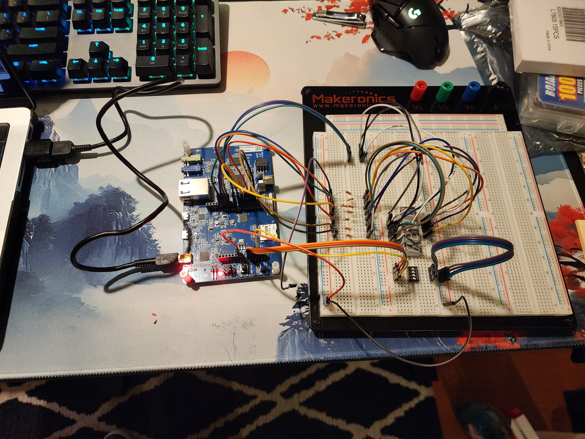
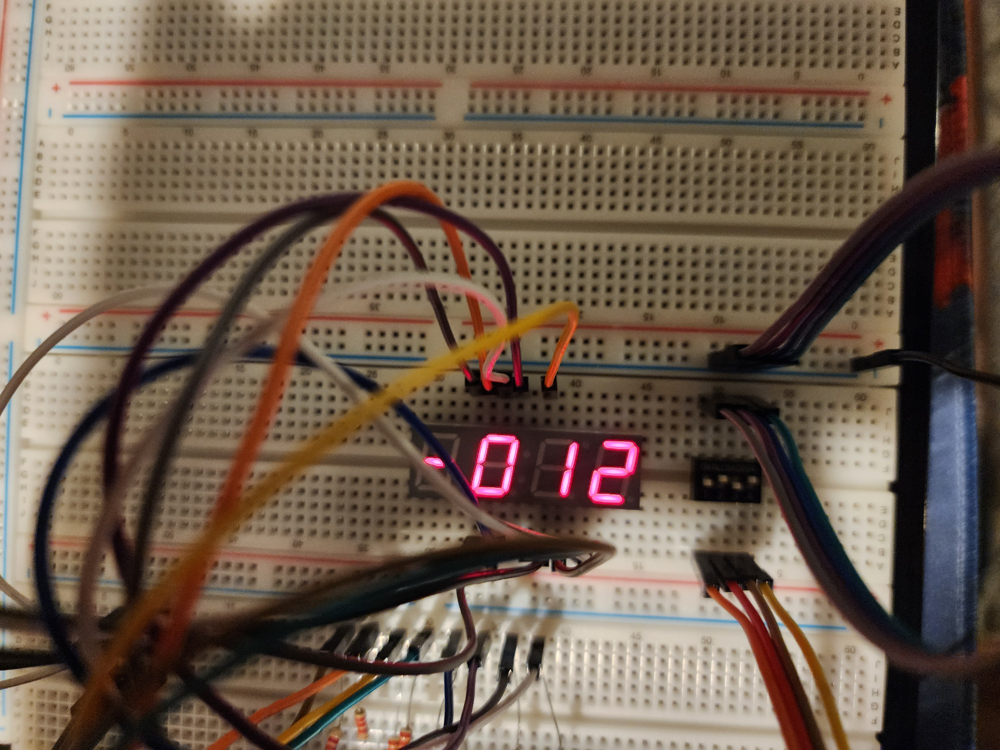
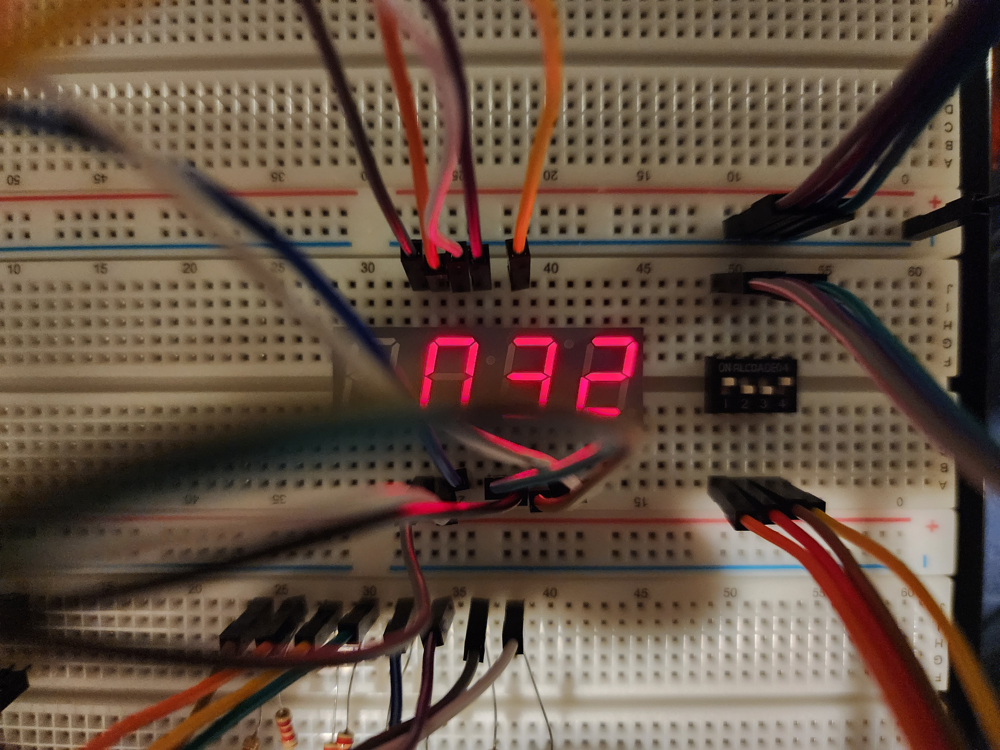
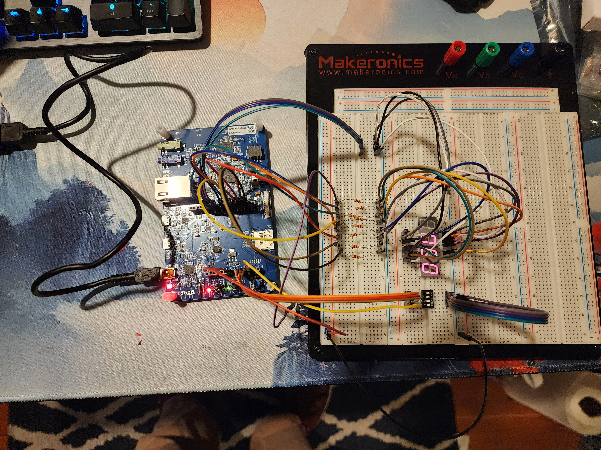

# Introduction

The main goal of this lab is to design and implement a hardware and software
interface between the **STM32F746G-DISCO microcontroller** and a **four-digit,
seven-segment LED display (LTC-4627JR)**. The lab focuses on configuring GPIO
registers using bare-metal C, controlling individual LED segments, and
implementing display multiplexing to present numerical values across all
four digits.

Additionally, the lab introduces four external push-button switches used
to control a basic calculator application. The calculator performs addition
and subtraction using two predefined two-digit numbers, displays the
calculated result, and allows the user to recall the previous result.

This lab reinforces concepts involving GPIO configuration, bitwise
operations, digital input handling, and hardware-software interfacing.

# Challenges

One of the primary challenges of this lab was understanding the hardware
interface between the STM32F746G-DISCO board and the LTC-4627JR display.
This required carefully reviewing the display's datasheet to identify
the correct pin assignments, common-anode configuration, and segment
connections.

Another challenge involved the current requirements of the display.
Because each digit shares a common anode, enabling multiple segments
simultaneously increases the current supplied by the corresponding
digit-select GPIO pin. Initial calculations suggested that the current
could exceed the recommended operating specifications of the STM32 GPIO
pins.

To address this issue, I increased the resistance of the current-limiting
resistors connected to the individual LED segments. This reduced the
overall current demand, allowing the display to be driven directly
through the GPIO pins without requiring additional transistor circuitry.

The software implementation also presented some challenges because the
display's segments were connected to GPIO pins spread across multiple
ports. To simplify the implementation, I created a structure containing
the GPIO port and pin information for each segment. This allowed the
display driver to control individual segments through a common function,
making the code easier to organize and maintain.

# Images

