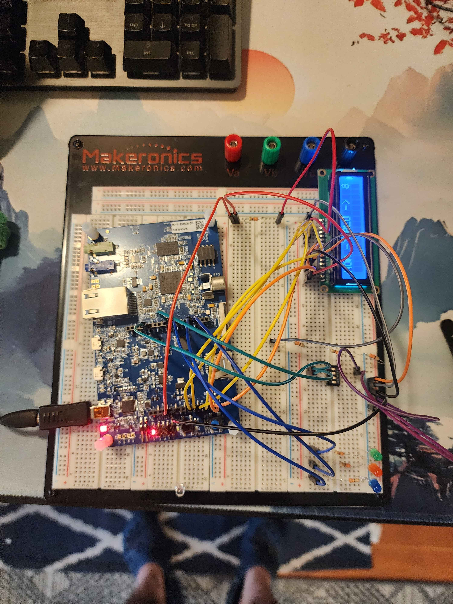
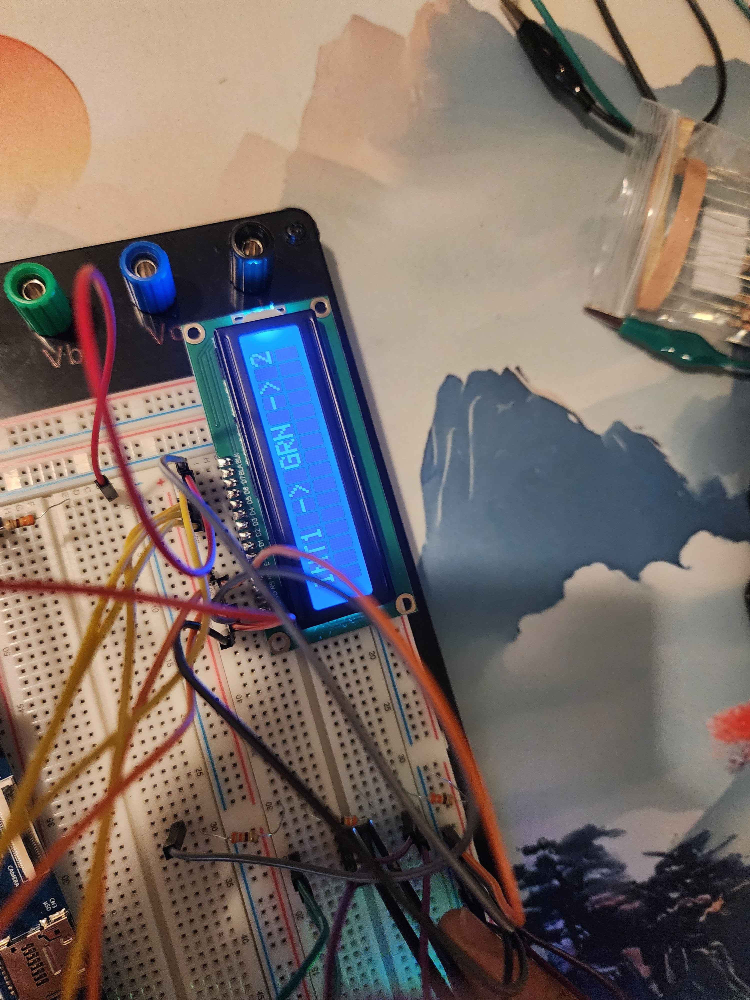
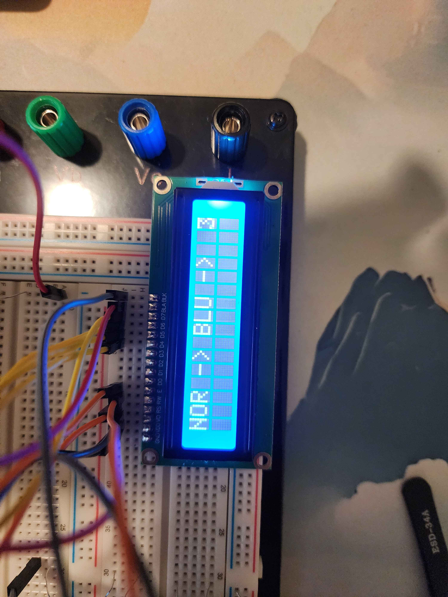
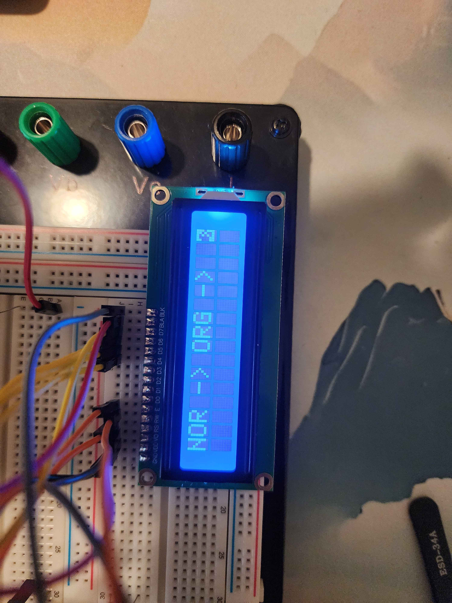

# Lab 3 — STM32F746G-DISCO

## Objective

Use three LEDs, TIM2 timing, two button interrupts, and a 1602A LCD in 4-bit mode to display the active LED sequence and blink count.

## Wiring

[Visual circuit schematic (PDF)](Lab_3_Circuit_Schematic.pdf)

GPIO assignments are verified against the supplied code; header locations follow ST UM1907. Power connections, LED polarity, and button-to-ground connections below describe the inferred hookup. The exact VO tap remains unconfirmed.

| Component / signal | MCU pin | Board connection | Wiring |
|---|---|---|---|
| Green LED1 | PI3 | D7 / CN4-8 | Through 330 Ω to anode; cathode to GND (inferred) |
| Orange LED2 | PB4 | D3 / CN4-4 | Through 330 Ω to anode; cathode to GND (inferred) |
| Blue LED3 | PG7 | D4 / CN4-5 | Through 330 Ω to anode; cathode to GND (inferred) |
| SW1 | PI1 | D13 / CN7-6 | Button to GND; internal pull-up enabled |
| SW2 | PI2 | D8 / CN7-1 | Button to GND; internal pull-up enabled |
| LCD 4, RS | PF6 | A5 / CN5-6 | LCD register select |
| LCD 6, E | PF7 | A4 / CN5-5 | LCD enable |
| LCD 11, DB4 | PA0 | A0 / CN5-1 | Data bit 4 |
| LCD 12, DB5 | PF10 | A1 / CN5-2 | Data bit 5 |
| LCD 13, DB6 | PF9 | A2 / CN5-3 | Data bit 6 |
| LCD 14, DB7 | PF8 | A3 / CN5-4 | Data bit 7 |
| LCD 1, VSS | — | GND / CN6-6 or CN6-7 | Common ground (inferred) |
| LCD 2, VDD | — | +5 V / CN6-5 | Typical supply; actual voltage unconfirmed |
| LCD 3, VO | — | Contrast divider tap | Three 330 Ω resistors in series; exact tap unconfirmed |
| LCD 5, R/W | — | GND | Write-only operation (inferred) |
| LCD 7–10, DB0–DB3 | — | Unconnected | Unused in 4-bit mode |
| LCD 15, A | — | Backlight supply | Preserve working current limiting; arrangement unconfirmed |
| LCD 16, K | — | GND | Backlight return (inferred) |

A5/A4 must route to PF6/PF7 rather than their alternate I²C pins. Reference: [ST UM1907](https://www.st.com/resource/en/user_manual/dm00190424-discovery-kit-for-stm32f7-series-with-stm32f746ng-mcu-stmicroelectronics.pdf).

## Plain-text schematic

```text
STM32F746G-DISCO                 1602A LCD
A5 / PF6 ---------------------- 4 RS
A4 / PF7 ---------------------- 6 E
A0 / PA0 ---------------------- 11 DB4
A1 / PF10 --------------------- 12 DB5
A2 / PF9 ---------------------- 13 DB6
A3 / PF8 ---------------------- 14 DB7

Inferred power wiring:
+5 V -------------------------- 2 VDD
GND --------------------------- 1 VSS, 5 R/W, 16 K
Backlight supply + limiting --- 15 A
Contrast divider tap ---------- 3 VO
LCD pins 7–10 unused

Inferred LED and button wiring:
D7 / PI3 -- 330 ohm -- green LED anode; cathode -- GND
D3 / PB4 -- 330 ohm -- orange LED anode; cathode -- GND
D4 / PG7 -- 330 ohm -- blue LED anode; cathode -- GND
D13/ PI1 -- SW1 -- GND (internal pull-up)
D8 / PI2 -- SW2 -- GND (internal pull-up)

Illustrative contrast divider; actual tap/rail unconfirmed:
Rail --[330 ohm]--o--[330 ohm]--o--[330 ohm]-- GND
                 T1          T2
LCD VO connects to the working tap; T1 vs T2 was not recorded.
```

The three contrast resistors are in series, totaling 990 Ω. In the illustrated divider, unloaded T1 is 2/3 of the rail and T2 is 1/3. These are calculations, not measured voltages.

## Program operation

- Normal mode: orange LED blinks five times, blue LED blinks eight times, then an eight-update pause precedes repetition.
- SW1 triggers EXTI1 and three green blinks. SW2 triggers EXTI2 and five blue blinks. SW2 has higher configured priority; handlers restore the prior display mode afterward.
- The LCD uses RS, E, and DB4–DB7, sending each byte as two nibbles. It displays mode, LED color, and blink count in column 16.
- TIM2 uses `PSC = 15999`, `ARR = 250`, and a polled update flag. Assuming a 16 MHz timer clock, each count is 1 ms and each update is 251 ms. A normal full blink is about 502 ms; the eight-update pause is about 2.008 s. Actual timing was not measured.
- Interrupt blinks use software delays. Button rearming requires 20 counts of stable release, about 20 ms under that clock assumption. Blocking interrupt handlers can delay the normal sequence.

### Full board and breadboard

Overall hardware, wiring, external LEDs, and powered LCD.
### INT1: green mode

LCD shows `INT1 -> GRN ->` with count `2`.
### Normal mode: blue

LCD shows `NOR -> BLU ->` with count `8`.
### Normal mode: orange

LCD shows `NOR -> ORG ->` with count `2`.
Photos establish readable status messages in normal and INT1 modes. Still images do not verify timing, complete blink sequences, or INT2 operation. They do not establish the exact VO tap or supply voltages reliably.


## Results and conclusion

Reported results: all three LEDs blinked, both button interrupts worked, and the completed lab operated correctly. The LCD initially showed blocks or poorly distinguishable text. Installing the VO contrast divider using three 330 Ω resistors in series made the text readable and resolved the final issue.

The final fault was LCD contrast. Code establishes intended blink counts and timing; exact periods and interrupt preemption were not independently measured. The VO tap, divider rail voltage, and LCD/backlight supply arrangement remain unconfirmed.
